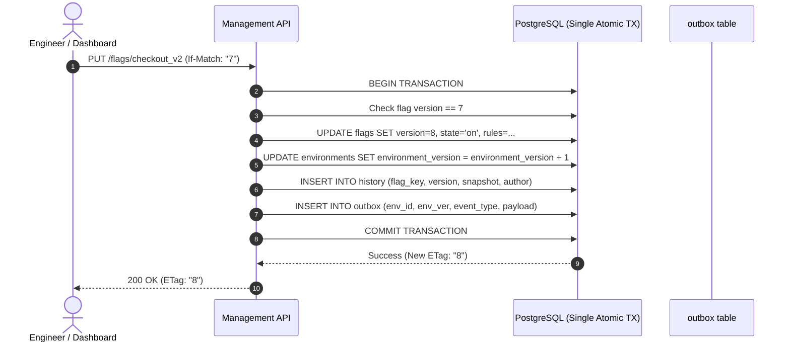

# Component Deep Dive: Management API

## 1. Executive Summary & Architectural Role

The **Management API** ([`cmd/mgmt-api/main.go`](file:///Users/arunap/Project/Lab/feature-flag-service/cmd/mgmt-api/main.go)) serves as the administrative control plane for the feature flag platform. It handles all flag authoring, segment definitions, environment scoping, and audit history.

Unlike the data plane (which handles millions of requests per second), the Management API handles relatively low write traffic (~15–20 updates/second across thousands of tenants), but demands **strict ACID transactional integrity**, **auditability**, and **safe concurrency controls**.



---

## 2. Code Structure & Key Packages

The service follows clean hexagonal/layered Go architecture:

```
internal/mgmt/
├── model/        # Domain entities (Flag, Segment, Rule, OutboxEventPayload)
├── repository/   # Raw SQL persistence & transactional guarantees
├── service/      # Business validation, version checks, and salting
└── handler/      # HTTP routing, header parsing, JSON serialization
```

- **Entry Point**: [`cmd/mgmt-api/main.go`](file:///Users/arunap/Project/Lab/feature-flag-service/cmd/mgmt-api/main.go)
- **HTTP Routing**: [`internal/mgmt/handler/common.go`](file:///Users/arunap/Project/Lab/feature-flag-service/internal/mgmt/handler/common.go#L22)
- **Flag Handlers**: [`internal/mgmt/handler/flag.go`](file:///Users/arunap/Project/Lab/feature-flag-service/internal/mgmt/handler/flag.go)
- **Transactional Service**: [`internal/mgmt/service/service.go`](file:///Users/arunap/Project/Lab/feature-flag-service/internal/mgmt/service/service.go)
- **SQL Repository**: [`internal/mgmt/repository/repository.go`](file:///Users/arunap/Project/Lab/feature-flag-service/internal/mgmt/repository/repository.go)

---

## 3. Core Architectural Mechanisms

### A. The Single Atomic Transaction (Zero Dual-Write Problem)
Writing to a database and publishing directly to Kafka in two sequential steps creates the infamous **dual-write problem** (if Kafka is unavailable, the DB commit cannot be undone; if DB crashes after Kafka send, state is inconsistent).

The Management API solves this by committing both the business state and the outbox event in **one atomic database transaction** inside [`repository.UpdateFlagTx`](file:///Users/arunap/Project/Lab/feature-flag-service/internal/mgmt/repository/repository.go#L225):

1. `UPDATE flags SET state = $1, version = $2, rules = $3, fallback_value = $4, salt = $5, updated_at = NOW()`
2. `UPDATE environments SET environment_version = environment_version + 1 WHERE id = $1 RETURNING environment_version`
3. `INSERT INTO history (flag_key, environment_id, version, state, rules, fallback_value, salt, change_reason, changed_by)`
4. `INSERT INTO outbox (environment_id, environment_version, event_type, payload)`

If any step fails, the entire transaction rolls back cleanly.

### B. Optimistic Concurrency Control vs. The 2:00 AM Kill Switch

Routine rule edits require optimistic concurrency checks via HTTP headers:
- Clients send `If-Match: "<version>"` (e.g. `If-Match: "4"`).
- If another operator bumped the flag to version `5` in the interim, the API aborts with `412 Precondition Failed` ([`repository.ErrVersionMismatch`](file:///Users/arunap/Project/Lab/feature-flag-service/internal/mgmt/repository/repository.go#L16)), preventing silent overwrites.

**The 2:00 AM Kill Switch Exception**:
When a production flag causes a critical system failure, an on-call engineer cannot afford to reload the dashboard or resolve version conflicts.
- Endpoint: `POST /api/v1/environments/{env_id}/flags/{flag_key}/kill`
- Implementation ([`service.KillFlag`](file:///Users/arunap/Project/Lab/feature-flag-service/internal/mgmt/service/service.go#L180)): **Bypasses the `If-Match` version check**. It reads the current version directly inside the database transaction, increments it, sets `state = 'off'`, and commits immediately.

### C. Deterministic Salting
When flags are created ([`service.CreateFlag`](file:///Users/arunap/Project/Lab/feature-flag-service/internal/mgmt/service/service.go#L134)), the service generates a random cryptographic salt (e.g., `crypto/rand` 8-byte hex). This salt is permanently stored with the flag and ensures that two distinct flags rolling out to 10% do not target the exact same 10% of users.

### D. 1-Click Atomic Rollbacks
Every state change appends a complete snapshot to the `history` table.
- Endpoint: `POST /api/v1/environments/{env_id}/flags/{flag_key}/rollback/{target_version}`
- The service retrieves the historic state at `target_version`, increments the current version monotonically, and writes an atomic update with `change_reason = "Rollback to version X"`.

---

## 4. Key API Endpoints

| Method | Endpoint | Description | Header Requirements |
| :--- | :--- | :--- | :--- |
| `POST` | `/api/v1/tenants` | Create tenant | `X-User: <username>` |
| `POST` | `/api/v1/tenants/{tenant_id}/environments` | Create environment | `X-User: <username>` |
| `POST` | `/api/v1/environments/{env_id}/keys` | Issue client or server SDK key | `X-User: <username>` |
| `POST` | `/api/v1/environments/{env_id}/flags` | Create flag with initial rules | `X-User: <username>` |
| `PUT` | `/api/v1/environments/{env_id}/flags/{key}` | Update flag state and targeting rules | `X-User`, `If-Match: <version>` |
| `POST` | `/api/v1/environments/{env_id}/flags/{key}/kill` | **Emergency Kill Switch** | `X-User: <username>` (No `If-Match`) |
| `POST` | `/api/v1/environments/{env_id}/flags/{key}/rollback/{ver}` | Rollback flag to historic version | `X-User: <username>` |
| `GET` | `/api/v1/environments/{env_id}/flags/{key}/history` | Audit log of all changes | `X-User: <username>` |
| `PUT` | `/api/v1/environments/{env_id}/segments/{key}` | Update target segment user list | `X-User`, `If-Match: <version>` |
| `GET` | `/api/v1/outbox` | Inspect recent pending/processed outbox records | None |

---

## 5. Concurrency & Failure Modes

1. **Database Lock Contention on Environments Table**:
   - Every flag change bumps `environment_version` on the `environments` table.
   - Under heavy write traffic to the same environment, the row in `environments` becomes a serialization point.
   - *Mitigation*: Flag authoring write rate is low (~17 writes/sec); PostgreSQL row-level locks hold for $< 2\text{ms}$.
2. **Crash Before Outbox Relay**:
   - If the Management API crashes immediately after transaction commit, the data is completely safe in PostgreSQL's WAL and `outbox` table. The Outbox CDC publisher will pick it up automatically.
