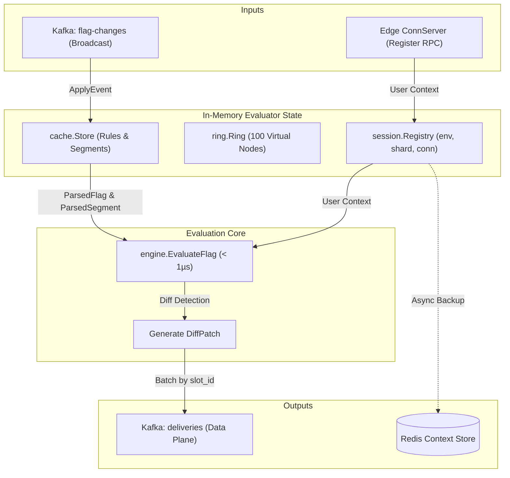
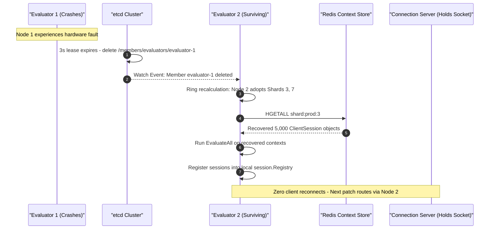

# Component Deep Dive: Evaluator Service

## 1. Executive Summary & Architectural Role

The **Evaluator Service** ([`cmd/evaluator/main.go`](file:///Users/arunap/Project/Lab/feature-flag-service/cmd/evaluator/main.go)) is the computational brain of the platform. It operates completely disconnected from the public internet behind edge Connection Servers.

Its primary missions:
1. **Sub-Microsecond Flag Checks**: Evaluate targeting rules in local memory in < 1µs without database access.
2. **Session Context Management**: Maintain active client contexts in memory partitioned across a consistent hash ring.
3. **Real-Time Delta Generation**: When a flag state changes, compute exact differences (`DiffPatch`) and dispatch them to Connection Servers via Kafka.
4. **Zero-Reconnect Failover**: If an evaluator crashes, surviving evaluators adopt its shards and recover contexts from Redis without dropping client sockets.



---

## 2. Code Structure & Submodules

```
internal/evaluator/
├── engine/        # Pure math and boolean logic: SHA-256 bucketing, flag evaluation
├── cache/         # Thread-safe in-memory storage of flags, segments, versions
├── ring/          # Consistent hash ring with virtual nodes for shard assignment
├── session/       # Active connection registry, shard-level diff evaluation
├── cluster/       # etcd lease maintenance, heartbeat, and member watch loops
└── contextstore/  # Redis client for session persistence and failover recovery
```

---

## 3. Sub-Microsecond Evaluation Engine ([`internal/evaluator/engine/engine.go`](file:///Users/arunap/Project/Lab/feature-flag-service/internal/evaluator/engine/engine.go))

Evaluation execution runs through a strict, zero-allocation priority ladder in [`EvaluateFlag`](file:///Users/arunap/Project/Lab/feature-flag-service/internal/evaluator/engine/engine.go#L104):

```
+-------------------------------------------------------------+
| 1. Emergency Kill Switch Check: if flag.State != "on"       |
|    -> Return flag.FallbackValue IMMEDIATELY                 |
+-------------------------------------------------------------+
                              │ (Flag is ON)
                              ▼
+-------------------------------------------------------------+
| 2. Iterate Targeting Rules in strict priority Order:        |
|    a. Segment Check: Is UserID in target Set? (O(1) map)    |
|    b. Rollout Check: SHA256(key + salt + user_id) % 100000 |
|       -> If Bucket < percentage * 1000: Rule Matches!       |
|    -> Return rule.Value                                     |
+-------------------------------------------------------------+
                              │ (No rules matched)
                              ▼
+-------------------------------------------------------------+
| 3. Fallback: Return flag.FallbackValue                      |
+-------------------------------------------------------------+
```

### Deterministic Salting & Bucketing
Rollout calculations use [`ComputeBucket`](file:///Users/arunap/Project/Lab/feature-flag-service/internal/evaluator/engine/engine.go#L93):
```go
func ComputeBucket(flagKey, salt, userID string) uint64 {
    h := sha256.New()
    h.Write([]byte(flagKey))
    h.Write([]byte(salt))
    h.Write([]byte(userID))
    sum := h.Sum(nil)
    val := binary.BigEndian.Uint64(sum[:8])
    return val % constants.RolloutBucketModulus // 100,000
}
```
- **Range**: `0` to `99,999` (allowing 0.001% rollout granularity).
- **Sticky Distribution**: The user gets the identical bucket on every request without requiring any state persistence.
- **Independence**: Because each flag stores a unique `salt`, a user in the 5% bucket for Flag A will be randomly distributed for Flag B.

---

## 4. Broadcast Ingestion & Dynamic Shard Evaluation

### A. Broadcast Ingestion
Evaluator nodes subscribe to Kafka `flag-changes` using a consumer group named `evaluator-<node_id>` ([`cmd/evaluator/main.go:217`](file:///Users/arunap/Project/Lab/feature-flag-service/cmd/evaluator/main.go#L217)). Because the group is unique to that process, Kafka broadcasts every event to every evaluator.

### B. Selective Shard Re-evaluation
When an event arrives:
1. `rulesStore.ApplyEvent(payload)` updates the local cache using Copy-on-Write semantics.
2. The node calculates which shards it currently owns via [`hashRing.GetOwnedShards`](file:///Users/arunap/Project/Lab/feature-flag-service/internal/evaluator/ring/ring.go#L98) + any local sessions in [`sessionRegistry.ActiveShards`](file:///Users/arunap/Project/Lab/feature-flag-service/internal/evaluator/session/session.go#L85).
3. It ignores shards owned by peer evaluators, keeping CPU load divided evenly across the fleet.

### C. Delta Generation ([`session.ReevaluateShard`](file:///Users/arunap/Project/Lab/feature-flag-service/internal/evaluator/session/session.go#L106))
For owned shards, the evaluator iterates over connected sessions and tests only the modified flag (or all flags if a segment changed):
- If `newVal == oldVal`: No patch is produced (silent ignore).
- If `newVal != oldVal`: It updates `sess.LastAnswers[key]` and appends a [`DiffPatch`](file:///Users/arunap/Project/Lab/feature-flag-service/internal/evaluator/session/session.go#L22):
  ```go
  type DiffPatch struct {
      ConnectionID string          `json:"connection_id"`
      ServerSlot   int             `json:"server_slot"`
      EnvID        string          `json:"env_id"`
      EnvVersion   int64           `json:"env_version"`
      Changes      map[string]bool `json:"changes"`
  }
  ```

---

## 5. Slot Mailbox Dispatch via Kafka

To avoid creating an M × N mesh of TCP connections between 20 Evaluators and 250 Connection Servers, the evaluator groups patches by `ServerSlot` (the slot ID of the target Connection Server, e.g., 1..8):

```go
// Map slotID to 0-indexed partition (slot 1 -> partition 0)
partition := int32((slotID - 1) % constants.DefaultDeliveriesPartitions)
rec := &kgo.Record{
    Topic:     constants.TopicDeliveries,
    Partition: partition,
    Value:     batchData,
}
deliveriesProducer.Produce(ctx, rec, ...)
```

The Connection Server for Slot 1 consumes only Partition 0, pulling exactly the patches meant for its clients.

---

## 6. Zero-Reconnect Failover Protocol



1. Each evaluator maintains a 3-second TTL lease in etcd ([`cluster.Coordinator`](file:///Users/arunap/Project/Lab/feature-flag-service/internal/evaluator/cluster/cluster.go#L18)).
2. On crash, etcd expires the lease and triggers the watch loop in surviving nodes.
3. The surviving node detects newly adopted shards in its [`onRingChange`](file:///Users/arunap/Project/Lab/feature-flag-service/cmd/evaluator/main.go#L148) callback.
4. It calls [`contextStore.GetShardSessions`](file:///Users/arunap/Project/Lab/feature-flag-service/internal/evaluator/contextstore/store.go#L59) to load the orphaned sessions from Redis.
5. It runs initial evaluation and registers them locally. The client never drops its connection to the edge Connection Server.
