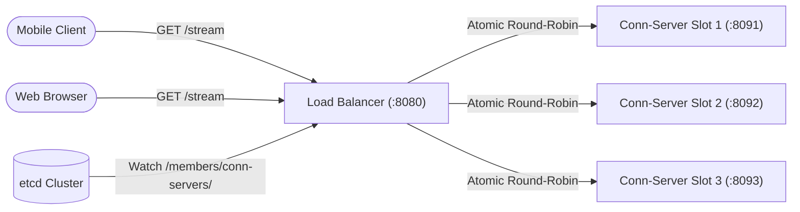

# Component Deep Dive: Load Balancer

## 1. Executive Summary & Architectural Role

The **Load Balancer** ([`cmd/load-balancer/main.go`](file:///Users/arunap/Project/Lab/feature-flag-service/cmd/load-balancer/main.go)) is the public entry point (:8080) for all incoming client traffic. It acts as an intelligent Layer 7 reverse proxy.

Its core duties:
1. **Dynamic Upstream Discovery**: Discovers live, healthy [Edge Connection Servers](file:///Users/arunap/Project/Lab/feature-flag-service/component/04-edge-connection-server.md) dynamically by watching etcd (`/members/conn-servers/`).
2. **Zero-Configuration Scalability**: When new connection servers start or die, the pool automatically adjusts in real time without reloading configuration files or restarting the load balancer.
3. **Immediate SSE Streaming**: Configures Go's reverse proxy with immediate flushing (`FlushInterval: -1`), ensuring real-time delta updates are never delayed by internal I/O buffers.



---

## 2. Code Structure & Key Packages

```
internal/lb/
├── balancer.go   # Dynamic UpstreamPool connected to etcd; atomic round-robin Next()
└── proxy.go      # ReverseProxy configuration with immediate SSE flushing & healthz
```

- **Entry Point**: [`cmd/load-balancer/main.go`](file:///Users/arunap/Project/Lab/feature-flag-service/cmd/load-balancer/main.go)
- **Upstream Pool**: [`internal/lb/balancer.go`](file:///Users/arunap/Project/Lab/feature-flag-service/internal/lb/balancer.go)
- **Proxy Server**: [`internal/lb/proxy.go`](file:///Users/arunap/Project/Lab/feature-flag-service/internal/lb/proxy.go)

---

## 3. Dynamic Upstream Pool via etcd ([`internal/lb/balancer.go`](file:///Users/arunap/Project/Lab/feature-flag-service/internal/lb/balancer.go))

Unlike static proxies (like vanilla NGINX or HAProxy) that require file rewrites and SIGHUP reloads when backends scale, this load balancer watches etcd continuously:

### A. Initial Refresh & Real-Time Watch
```go
resp, err := p.client.Get(ctx, constants.EtcdPrefixConnServers, clientv3.WithPrefix())
// Parse endpoints into []*url.URL
```
It immediately launches a background goroutine watching `constants.EtcdPrefixConnServers`:
```go
rch := p.client.Watch(ctx, constants.EtcdPrefixConnServers, clientv3.WithPrefix())
for wresp := range rch {
    p.refresh(ctx)
}
```
If a connection server crashes, its 3-second etcd lease expires. The load balancer receives a `DELETE` watch event and removes that node from its target list in < 3 seconds.

### B. Lock-Free Atomic Round-Robin
Request dispatching uses lock-free atomic counters for peak throughput:
```go
func (p *UpstreamPool) Next() (*url.URL, error) {
    p.mu.RLock()
    defer p.mu.RUnlock()

    if len(p.targets) == 0 {
        return nil, errors.New(constants.ErrMsgNoUpstreamsAvailable)
    }

    n := atomic.AddUint64(&p.counter, 1)
    idx := int((n - 1) % uint64(len(p.targets)))
    return p.targets[idx], nil
}
```

---

## 4. The Critical Reverse Proxy Gotcha: `FlushInterval: -1`

Standard HTTP reverse proxies buffer upstream response bodies in memory chunks (typically 32 KB) to optimize TCP packet utilization.

For **Server-Sent Events (SSE)**, buffering is disastrous:
- An SSE event like `event: patch\ndata: {"flag": false}\n\n` is only ~50 bytes.
- If buffered, the client will **never receive the flag update** until 32 KB of keepalives have passed (potentially hours later!).

The load balancer solves this in [`internal/lb/proxy.go:60`](file:///Users/arunap/Project/Lab/feature-flag-service/internal/lb/proxy.go#L60) by setting:
```go
proxy := &httputil.ReverseProxy{
    Director:      director,
    FlushInterval: -1, // CRITICAL: -1 forces immediate flushing for real-time SSE stream events
    ErrorHandler:  errorHandler,
}
```
Setting `FlushInterval: -1` instructs Go's reverse proxy to flush bytes directly to the downstream socket the moment they are written by the Connection Server.

---

## 5. Header Handling & Graceful Draining

1. **`X-Forwarded-For` Management**:
   The `Director` appends the client's `RemoteAddr` to the `X-Forwarded-For` header chain to preserve end-user identity for upstream evaluation.
2. **Graceful Draining**:
   When the process receives `SIGTERM`, it executes a 10-second timeout context:
   ```go
   shutdownCtx, shutdownCancel := context.WithTimeout(context.Background(), 10*time.Second)
   srv.Shutdown(shutdownCtx)
   ```
   This allows in-flight HTTP requests and initial handshake hand-offs to complete before terminating.
