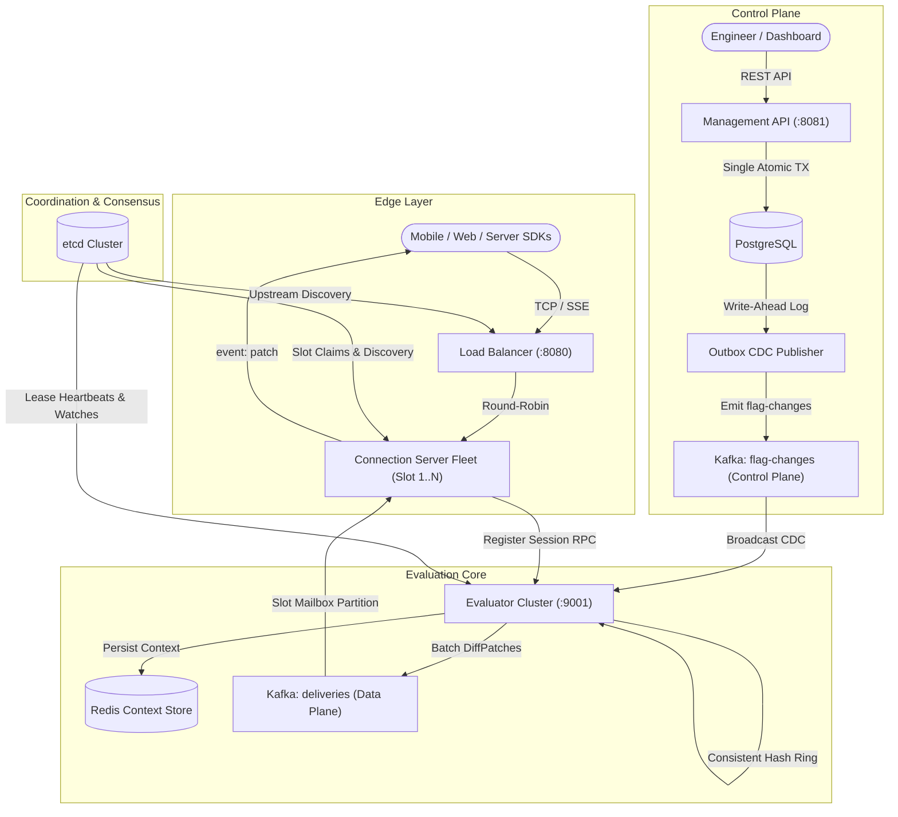

# Distributed Feature Flag System: Component Deep Dives

This directory contains in-depth architectural and implementation breakdowns of every service and coordination layer in the distributed real-time feature flag platform.

---

## Service & Infrastructure Directory

| Document | Service / Component | Primary Responsibility | Critical Guarantees |
| :--- | :--- | :--- | :--- |
| [01. Management API](file:///Users/arunap/Project/Lab/feature-flag-service/component/01-management-api.md) | `management-api` | Flag, segment, and environment CRUD; optimistic locking. | Sub-second emergency kill switches; zero dual-write risk via PostgreSQL transactional outbox. |
| [02. Outbox CDC Publisher](file:///Users/arunap/Project/Lab/feature-flag-service/component/02-outbox-cdc-publisher.md) | `outbox-cdc-publisher` | Low-latency PostgreSQL WAL log-based CDC streaming. | Zero polling overhead; verified LSN flush confirms delivery to Kafka control plane without WAL bloat. |
| [03. Evaluator Engine](file:///Users/arunap/Project/Lab/feature-flag-service/component/03-evaluator-service.md) | `evaluator` | In-memory < 1µs rule calculation and session state. | Consistent hash ring partition; Copy-on-Write cache; delta diff calculation on flag flip. |
| [04. Edge Connection Server](file:///Users/arunap/Project/Lab/feature-flag-service/component/04-edge-connection-server.md) | `conn-server` | Edge SSE connection holder. | Stateless blast-radius isolation; zero rules stored; slot-mailbox Kafka consumer. |
| [05. Load Balancer](file:///Users/arunap/Project/Lab/feature-flag-service/component/05-load-balancer.md) | `load-balancer` | Layer 7 reverse proxy with dynamic discovery. | Immediate SSE stream flushing (`FlushInterval: -1`); dynamic etcd connection server tracking. |
| [06. etcd Distributed Coordination](file:///Users/arunap/Project/Lab/feature-flag-service/component/06-etcd-coordination.md) | `etcd` | Raft-backed decentralized cluster coordinator. | 3-second heartbeat leases; real-time topology watch events; split-brain prevention. |
| [07. Redis Context Store](file:///Users/arunap/Project/Lab/feature-flag-service/component/07-redis-context-store.md) | `redis` | Durable, fast-delete session context backup. | Zero-reconnect evaluator failover; orphaned shard session recovery without dropping client streams. |
