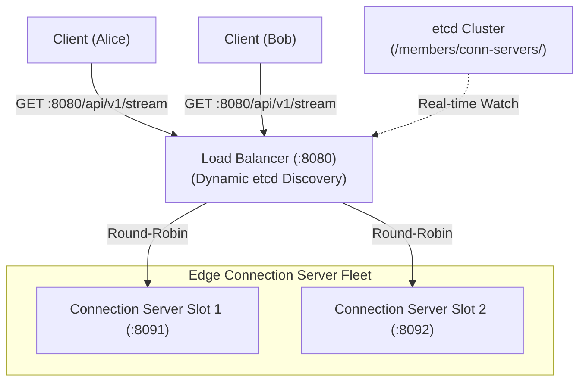

# Layer 4 vs Layer 7 Load Balancing & Real-Time SSE Proxying

In a real-time distributed feature flag architecture, client SDKs (mobile apps, web SPAs, microservices) maintain persistent long-lived TCP/HTTP connections to receive instant configuration changes. 

The **Load Balancer** serves as the public gateway fronting the Edge Connection Server fleet.

---

## 1. Why Front Connection Servers with a Load Balancer?



1. **Single Stable VIP / DNS Endpoint**: Clients only ever connect to `flags.company.com:8080`. They have no knowledge of how many edge connection servers exist behind the scenes.
2. **Horizontal Scalability**: When connection traffic surges, edge connection servers can scale from 2 to 20 nodes without client reconfiguration.
3. **Zero-Downtime Rolling Restarts**: Nodes can be taken out of rotation gracefully while the load balancer redistributes new client streams to remaining healthy nodes.

---

## 2. Layer 4 vs Layer 7 Load Balancing

| Dimension | Layer 4 (Transport / TCP) | Layer 7 (Application / HTTP) |
| :--- | :--- | :--- |
| **OSI Layer** | Layer 4 (Transport) | Layer 7 (Application) |
| **Protocol Awareness** | Raw TCP / UDP packets | HTTP/1.1, HTTP/2, SSE, WebSockets |
| **Routing Decisions** | IP address & Port tuples | URL path, query params, headers, cookies |
| **TLS Termination** | Pass-through or TCP termination | Full TLS termination & certificate handling |
| **Header Enrichment** | None (unless using PROXY protocol) | Adds `X-Forwarded-For`, `X-Request-ID` |
| **Throughput & Latency** | Ultra-high throughput, lowest CPU | Higher CPU overhead, deeper packet inspection |
| **Choice for Edge Gateway** | Cloud ingress / AWS NLB | Edge Reverse Proxy / Envoy / Service LB |

In our feature flag architecture, we employ a **Layer 7 Reverse Proxy** because:
- It serves application health checks (`GET /healthz`) inspecting backend pool membership.
- It routes specific paths (`/api/v1/stream`) to connection servers.
- It enriches client requests with standard `X-Forwarded-For` headers so downstream edge servers know the originating client's IP.

---

## 3. The Server-Sent Events (SSE) Proxying Gotcha: Immediate Flushing

Standard HTTP reverse proxies buffer upstream response bodies in memory (typically 4KB or 8KB buffers) to minimize network syscalls and maximize TCP packet density:

```
[Upstream Server] ---> [LB Buffer: [chunk1][chunk2]... wait until 4KB ] ---> [Client]
```

### The Problem with Buffering in SSE
In Server-Sent Events, frames are tiny (e.g. `event: patch\ndata: {"show_animation": false}\n\n` is $\approx 60$ bytes). 
- If the reverse proxy buffers chunks, the client **will not receive** the flag change until either:
  1. Many more changes arrive and fill up the 4KB buffer.
  2. The server sends periodic keepalive pings over several minutes.
  3. The connection closes.
- This completely destroys real-time flag updates and instant kill switches!

### The Solution: `FlushInterval: -1`
In Go's `net/http/httputil.ReverseProxy`, the field `FlushInterval` governs chunk buffering:

```go
proxy := &httputil.ReverseProxy{
    Director:      director,
    FlushInterval: -1, // Negative duration forces immediate flush after every write!
    ErrorHandler:  errorHandler,
}
```

When `FlushInterval: -1` is configured:
1. As soon as the upstream Connection Server emits a frame (`fmt.Fprintf(w, "event: patch\ndata: %s\n\n", payload)` followed by `flusher.Flush()`), the Load Balancer's proxy copies the bytes and immediately flushes the TCP socket to the client.
2. Latency across the Load Balancer for real-time events is $< 1\text{ ms}$.

---

## 4. Dynamic Upstream Discovery via etcd

Instead of static configuration files (which require manual edits and reloads) or DNS-based discovery (which suffers from DNS caching and TTL delays), our Load Balancer uses **etcd real-time prefix watches**:

1. **Self-Registration with Leases**:
   Every Connection Server node claims a unique slot key in etcd on startup with a 3-second heartbeat lease:
   ```
   /members/conn-servers/slot-1 -> "http://conn-server:8091"
   /members/conn-servers/slot-2 -> "http://conn-server-2:8092"
   ```
2. **Load Balancer Prefix Watch**:
   The Load Balancer initiates an etcd watch on `/members/conn-servers/`:
   ```go
   rch := p.client.Watch(ctx, constants.EtcdPrefixConnServers, clientv3.WithPrefix())
   ```
3. **Atomic Upstream Updates**:
   When an event occurs (new slot registered, or a slot dies and its lease expires after 3s), the Load Balancer re-evaluates healthy targets and updates its slice under an `RWMutex`.
4. **Lock-Free Round Robin**:
   Requests are routed to targets using an atomic counter:
   ```go
   idx := atomic.AddUint64(&p.counter, 1) % uint64(len(p.targets))
   return p.targets[idx], nil
   ```

---

## 5. End-to-End Verification

During live cluster testing:
1. **Client-Alice** connected via `http://localhost:8080/api/v1/stream?env_id=...&user_id=usr_alice` and was routed to **Connection Server Slot 1** (`:8091`).
2. **Client-Bob** connected via `http://localhost:8080/api/v1/stream?env_id=...&user_id=usr_bob` and was routed to **Connection Server Slot 2** (`:8092`).
3. Both clients immediately received initial `put` payloads with evaluated flags over port `8080`.
4. An operator triggered a **Kill Switch** on flag `show_animation` via `POST :8081/api/v1/environments/.../flags/show_animation/kill`.
5. Outbox CDC $\to$ Kafka `flag-changes` $\to$ Evaluator Fleet re-evaluated Alice and Bob from Redis Context Store $\to$ Kafka `deliveries` (mailboxes 0 and 1) $\to$ Connection Server Slots 1 & 2 $\to$ Load Balancer (:8080) $\to$ Clients received `event: patch` with zero buffering.
6. When `conn-server-2` was stopped (`docker stop ff-conn-server-2`), its etcd lease expired in 3 seconds, and `/healthz` instantly downgraded active backends from 2 to 1 without dropping active connections on Slot 1.
