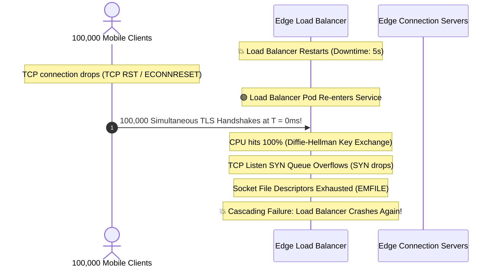

# Client Reconnect Storms, Thundering Herds & Full Jitter Exponential Backoff

When edge infrastructure crashes and recovers in a distributed system with hundreds of thousands of connected mobile and IoT clients, the recovery itself often causes a catastrophic secondary outage: **The Thundering Herd (Reconnect Storm)**.

---

## 1. The Core Questions

> **Question 1**: *"What happens if the Load Balancer is down? The entire system is down, and when it comes back up, we again have a thundering herd problem, right?"*

> **Question 2**: *"With Full Jitter Exponential Backoff, how can we be sure mobile clients will get different jitter? They are independent—won't they accidentally send requests at the same time again?"*

---

## 2. Anatomy of a Reconnect Storm (Why Load Balancers Collapse)

Suppose a Load Balancer crashes or undergoes a rolling restart with $N = 100,000$ active Server-Sent Events (SSE) or WebSocket client connections.



### The Three Resource Chokepoints
1. **Asymmetric Cryptographic Cost (TLS Handshakes)**:
   - Establishing a TLS 1.3 session requires an elliptic curve Diffie-Hellman key exchange.
   - 100,000 simultaneous handshakes require millions of floating-point CPU cycles in a 1-second window, choking CPU cores before a single byte of HTTP payload is processed.
2. **TCP Listen SYN Backlog Overflow**:
   - The OS kernel maintains a `somaxconn` SYN backlog queue (typically 1,024–4,096 entries).
   - If 100,000 TCP `SYN` packets arrive in the same 10-millisecond slice, the queue overflows, causing silent kernel packet drops.
3. **Cascading Retry Amplification**:
   - Dropped clients immediately retry, creating a vicious feedback loop where load grows exponentially with failure duration.

---

## 3. Mathematical Proof: Impulse Spike vs. Continuous Uniform Distribution

### Without Jitter: Fixed Exponential Backoff
If mobile SDKs implement traditional exponential backoff without jitter:
$$\text{sleep} = \min\left(M, B \times 2^{\text{attempt}}\right)$$
Where $B = 1\text{s}$ base, $M = 30\text{s}$ cap.

- **Attempt 1**: All $100,000$ devices disconnect at $t_0$.
- All $100,000$ devices compute $\text{sleep} = 1.000\text{s}$.
- At $t_0 + 1.000\text{s}$, all $100,000$ packets hit the server at the exact same millisecond.
- **The Result**: An **impulse spike** with near-infinite instantaneous derivative:

$$\lim_{\Delta t \to 0} \frac{100,000 \text{ requests}}{\Delta t} = \infty$$

### With Full Jitter (AWS Architecture Standard)
Full Jitter samples an independent uniform random variable between $0$ and the exponential ceiling:

$$V = \min\left(M, B \times 2^{\text{attempt}}\right)$$
$$\text{sleep}_i = \text{random}(0, V)$$

For attempt 2 where $V = 30\text{s}$, each client $i$ independently chooses a sleep duration $S_i \sim \mathcal{U}(0, 30)$.

The arrival rate $\lambda(t)$ at the Load Balancer becomes a continuous uniform distribution:

$$\lambda(t) = \frac{N}{V} = \frac{100,000 \text{ clients}}{30 \text{ seconds}} \approx 3,333 \text{ requests/sec}$$

```
Request Rate (req/sec)
▲
│    Fixed Backoff Impulse (100k req in 1ms)
│         │
│         │   ◄── Crashes Load Balancer!
│         │
│         │
│──────────────────────────────────────────
│    Full Jitter Distribution (~3,333 req/sec)
│    ┌────────────────────────────────────┐  ◄── Fits comfortably within
│    │                                    │      TCP backlog capacity
└────┴────────────────────────────────────┴─────► Time (s)
     0s                                  30s
```

---

## 4. Addressing the Core Doubt: "Won't Independent Clients Accidentally Send at the Same Time?"

> *"How can we be sure mobile clients will get different jitter? They are independent, won't they accidentally send requests at the same time again?"*

### Fact 1: Some clients WILL send at the exact same millisecond—and that is 100% fine!
In any given 10-millisecond slice:
$$\frac{3,333 \text{ req/sec}}{100 \text{ slices/sec}} \approx 33 \text{ requests per 10ms}$$
A production Layer-7 Load Balancer (Envoy, NGINX, AWS ALB) is built to ingest **20,000 to 100,000 handshakes per second**.
The objective of jitter is **not** to assign every smartphone a globally unique microsecond slot; the objective is to **eliminate the impulse spike** and transform it into a steady, manageable Poisson arrival process.

### Fact 2: Physical Network Delays Naturally Break Synchronization
Even if two devices draw the identical random float `12.438s`:
1. **Cellular Radio Scheduling (4G/5G Physical Layer)**:
   - Handsets do not transmit packets at will. They must send a Scheduling Request (SR) to the base station (eNodeB / gNodeB).
   - The cell tower allocates uplink Resource Blocks in discrete 1-millisecond subframes across multiple user equipment (UE). The radio network physically serializes packets.
2. **Round-Trip Time (RTT) Variance**:
   - Devices on different cellular bands, Wi-Fi networks, and geographical regions experience physical latency variations ranging between $15\text{ms}$ and $350\text{ms}$.
3. **Mobile OS Battery Batching**:
   - Modern mobile operating systems (iOS `URLSessionTask`, Android `WorkManager`) intentionally batch and defer background network wakeups to conserve power, naturally staggering execution timers.

---

## 5. Implementation: Full Jitter vs. Decorrelated Jitter

In the mobile Client SDK:

```go
package client

import (
	"math"
	"math/rand"
	"time"
)

// FullJitterBackoff calculates sleep duration using AWS Full Jitter:
// sleep = rand(0, min(cap, base * 2^attempt))
func FullJitterBackoff(attempt int, base time.Duration, cap time.Duration) time.Duration {
	// Calculate exponential ceiling: base * 2^attempt
	multiplier := math.Pow(2, float64(attempt))
	ceiling := float64(base) * multiplier

	if ceiling > float64(cap) {
		ceiling = float64(cap)
	}

	// Uniform random sample between [0, ceiling)
	jittered := rand.Float64() * ceiling
	return time.Duration(jittered)
}

// DecorrelatedJitter (Marc Brooker, AWS Principal Engineer)
// sleep = min(cap, rand(base, previous_sleep * 3))
func DecorrelatedJitter(previous time.Duration, base time.Duration, cap time.Duration) time.Duration {
	low := float64(base)
	high := float64(previous) * 3.0

	if high < low {
		high = low
	}

	sleep := low + rand.Float64()*(high-low)
	if sleep > float64(cap) {
		sleep = float64(cap)
	}
	return time.Duration(sleep)
}
```

---

## 6. Production Edge Defenses: Multi-Layer Resilience

Beyond client-side jitter, production architectures deploy three additional defensive layers:

### 1. High-Availability Multi-LB with BGP / Anycast
Never run a single Load Balancer container. In production:
- Multiple Load Balancers share a single virtual Anycast IP via BGP routing.
- If Load Balancer 1 restarts, upstream routers immediately divert packets to Load Balancer 2 and 3 with zero connection loss for unaffected nodes.

### 2. Edge Connection Admission Control (Token Bucket)
The Load Balancer enforces rate limits on new TLS handshakes:
```nginx
# Limit new handshakes to 2,500/s with a burst queue of 1,000
limit_req_zone $binary_remote_addr zone=handshake_limit:10m rate=2500r/s;
limit_req zone=handshake_limit burst=1000 nodelay;
```
If the rate is exceeded, excess clients receive HTTP `503 Service Unavailable` with a `Retry-After: 15` header.

### 3. Stale-While-Revalidate Local Cache
While the Load Balancer is unreachable, the mobile app **must never break or block the user interface**:
- The SDK serves flags immediately from its local SQLite / AsyncStorage cache (`stale-while-revalidate`).
- Feature flags evaluate synchronously in $< 1\mu\text{s}$ locally while reconnection runs silently in the background.
