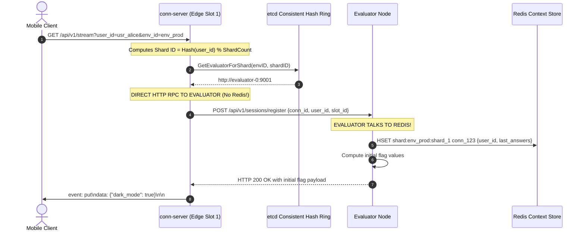

# Edge Server Boundaries, Session Coupling & Why Edge Servers Shouldn't Talk to Redis

In distributed real-time architectures, defining strict component boundaries between the **Edge Tier** (network socket management) and the **Evaluation/State Tier** (business rules and session storage) is essential for scalability, fault isolation, and preventing cascading failures.

---

## 1. The Core Question & Debate

> **Question**: *"Is it a good idea to make the edge server talk to Redis, and then put data into it in case of failure? I don't think that's the right thing, but we can debate..."*

### The Verdict: You Are Correct
Having the Edge Server connect to Redis—and especially having it act as an active backup / re-hydration agent for Redis—is an **architectural anti-pattern**. 

---

## 2. The Actual Codebase Architecture (Who Actually Talks to Redis?)

In our codebase, the Edge Server (`conn-server`) **never talks to Redis**. 

Let's trace the actual execution path:



### Verification from Source Code:
1. **Edge Server ([`internal/connserver/server/server.go`](file:///Users/arunap/Project/Lab/feature-flag-service/internal/connserver/server/server.go#L97-L125))**:
   - The Edge Server computes `shardID := engine.ComputeShard(userID, s.shardCount)`.
   - It queries `s.coordinator.GetEvaluatorForShard(envID, shardID)`.
   - It executes `s.httpClient.Post(evaluatorAddr + "/api/v1/sessions/register", ...)`.
   - **`conn-server` imports zero Redis packages and holds zero Redis connection pools.**

2. **Evaluator Server ([`internal/evaluator/contextstore/store.go`](file:///Users/arunap/Project/Lab/feature-flag-service/internal/evaluator/contextstore/store.go#L41-L50))**:
   - The Evaluator receives the HTTP registration request.
   - The Evaluator executes `s.client.HSet(ctx, key, sess.ConnectionID, data)`.
   - The Evaluator is the **sole owner** of the Redis connection.

---

## 3. Why the "Edge Talks to Redis" Pattern is an Anti-Pattern

If we were to modify the architecture so Edge Servers talk directly to Redis to manage and re-hydrate session state, three major design flaws emerge:

### 1. Violation of the Single Responsibility Principle (SRP)
- **The Edge Server's sole responsibility**: High-concurrency I/O multiplexing. It holds 50,000 to 100,000 persistent TCP sockets, manages TLS termination, flushes SSE frames, and handles client heartbeats.
- **Why coupling to Redis breaks it**: If Edge Servers must connect to Redis, the edge handshake (`GET /api/v1/stream`) becomes synchronous with Redis latency. If Redis experiences lock contention, latency spikes, or garbage collection pauses, edge connection handshakes stall, exhausting socket buffers on the ingress layer.

### 2. The Circular Dependency Anti-Pattern
```
[Edge Server] ──(relies on)──► [Redis] ──(relies on Edge to re-hydrate memory after crash)──► [Edge Server]
```
If the Evaluator depends on Redis for active sessions, but Redis depends on Edge Servers to restore its state after a restart, you create a circular dependency. Who is the true source of truth? Neither. Both are partial mirrors, making consistent recovery impossible.

### 3. Resource Waste on the Edge Layer
Maintaining an open connection pool to Redis from every Edge Server consumes file descriptors and memory that should be dedicated to holding client sockets. If you scale from 2 to 20 Edge Servers, you multiply connection pressure on the Redis primary by $10\times$.

---

## 4. Does the Entire System Go Down When Redis Dies?

A common fear is that if Redis crashes, the entire feature flag platform is down. 

**This is not true.** Distributed systems distinguish between the **Read/Evaluation Path** and the **Update/Push Path**:

```
                       ┌───────────────────────────────┐
                       │ Does it fail if Redis dies?   │
┌──────────────────────┼───────────────────────────────┤
│ Existing Mobile Apps │ ❌ NO. Fully functional!      │
│ Server SDKs          │ ❌ NO. Fully functional!      │
│ Management REST API  │ ❌ NO. Fully functional!      │
│ Real-Time Delta Push │ ⚠️ YES. Temporarily paused.   │
└──────────────────────┴───────────────────────────────┘
```

### Why Existing Connected Mobile Clients Do Not Go Down:
- When a mobile client first connects, it receives the complete dictionary of feature flags via the initial SSE `put` event.
- The client SDK stores this dictionary in **local device memory** (and persists it to SQLite / AsyncStorage).
- When application code calls `if (flags.isEnabled("checkout_v2"))`, evaluation happens **synchronously in memory on the device**.
- If Redis dies, the client's local dictionary is untouched. The mobile user experiences zero broken features and zero latency degradation.

### What Actually Pauses When Redis Dies:
- If an operator toggles a flag in the Management API during a Redis outage, the Evaluator receives the change from Kafka, attempts to query `HGETALL shard:env_prod:shard_1` in Redis, and encounters a connection error.
- Because the Evaluator cannot read the active session list, it **pauses pushing real-time delta patches**.
- As soon as Redis recovers (or fails over to a replica), delta pushes resume immediately.

---

## 5. Architectural Summary: Clean Separation of Tiers

| Tier | Component | Responsibilities | State Lifecycle |
| :--- | :--- | :--- | :--- |
| **Edge Gateway** | `load-balancer` (L7) | TLS termination, HTTP path routing, immediate SSE chunk flushing (`FlushInterval: -1`). | **Stateless** |
| **Edge Stream** | `conn-server` | Manages persistent client TCP sockets, dispatches shard requests to Evaluators, delivers Kafka mailbox frames. | **Stateless Edge** (Local socket registry only) |
| **Compute Engine**| `evaluator` | Dynamic virtual node hash ring (`etcd`), rule AST evaluation, computing `new != old` diffs. | **Stateless Worker** |
| **Context Store** | `redis` | Sharded active user context attributes (`shard:<env>:<shard>`) and connection slot mappings. | **Volatile Session State** (Backed by Replication) |
| **Source of Truth**| `postgresql` | Flag rules, segments, cryptographic rollout salts, transactional outbox log. | **Durable Persistent State** |
