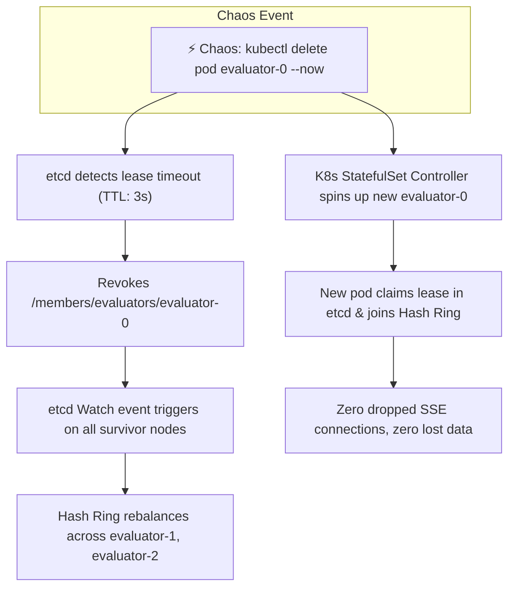
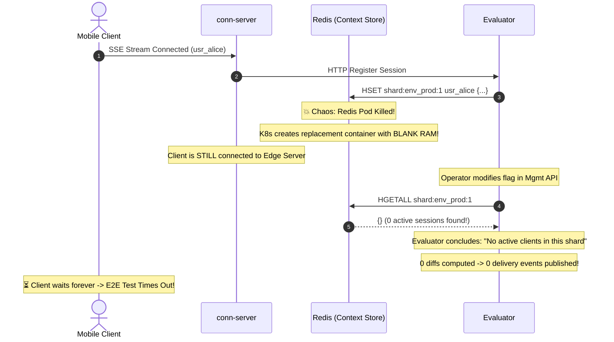
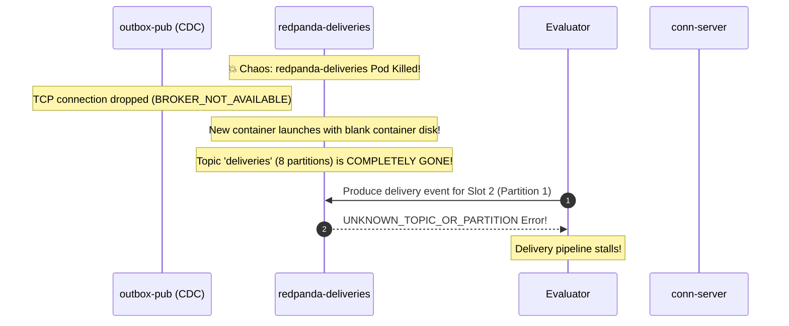
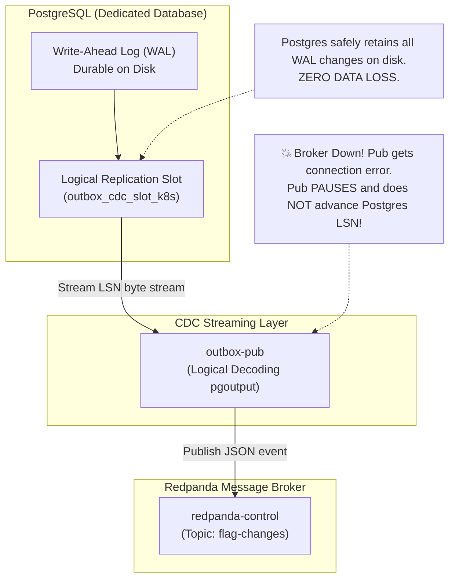

# Chaos Engineering & Failure Domains: Stateless vs. Stateful Components in Kubernetes

Chaos engineering deliberately injects failures into a distributed cluster to verify fault-tolerance mechanisms and identify single points of failure (SPOFs).

During our chaos testing against the local Kubernetes cluster, an important architectural contrast was uncovered:
- **Killing `evaluator-0` or `conn-server-0` passed seamlessly** with automated self-healing.
- **Killing `redis` or `redpanda` caused the closed-loop E2E verification test to fail.**

This document details the exact failure mechanisms, why this asymmetry occurred, and how event-driven backpressure protects data integrity.

---

## 1. The Core Questions

> **Question 1**: *"What happens if I kill Redpanda or Redis? The E2E test failed in that case."*

> **Question 2**: *"When Redpanda is down, CDC won't process for some time, so no change is sent to the Evaluator; and if the deliveries Redpanda is down, our connection server will wait until it's up, right?"*

---

## 2. Why Stateless Workers Healed Instantly Under Chaos

When `evaluator-0` or `conn-server-0` was killed, the cluster recovered in under 3 seconds:

### The Architectural Invariants that Enabled Instant Healing:
1. **Stateless Compute**: Evaluators hold no unique state on local container disk. All flag rule ASTs are derived from PostgreSQL via Kafka; active sessions are held in Redis; cluster topology is held in `etcd`.
2. **Consistent Hash Ring Virtual Nodes**: Evaluators register with 100 virtual nodes each. When node 0 dies, exactly $1/N$ of the shard keyspace smoothly migrates to the surviving nodes with minimal disruption.
3. **Automated Upstream Discovery**: The Layer-7 Load Balancer dynamically watches `etcd` (`/members/conn-servers/*`). When a connection server dies, the Load Balancer purges it from the upstream pool before the next client handshake arrives.

---

## 3. Why Killing Redis or Redpanda Failed in Local Kubernetes

In our local Kubernetes deployment ([`deploy/k8s/`](file:///Users/arunap/Project/Lab/feature-flag-service/deploy/k8s/)), Redis and Redpanda were provisioned as single-replica **development containers** without multi-node clustering or Persistent Volumes:

### Failure Mode A: Redis Context Loss (Volatile RAM Erasure)

1. **Ephemeral RAM Storage**: In [`deploy/k8s/03-redis.yaml`](file:///Users/arunap/Project/Lab/feature-flag-service/deploy/k8s/03-redis.yaml), Redis runs with no PersistentVolumeClaim (PVC) and without Append-Only File persistence (`appendonly no`).
2. **Evaluator "Blindness"**: When the new container starts, memory is empty. The Evaluator queries Redis, finds zero active users, and emits zero patch events. The connected mobile client never receives the flag update.

---

### Failure Mode B: Redpanda Single-Broker Partition Destruction

1. **Single-Broker Development Mode**: Both `redpanda-control` and `redpanda-deliveries` run with `--mode=dev-container` as single pods.
2. **Loss of Custom Topic Partitions**: Our Evaluator addresses connection slots using partition routing: $\text{partition} = (\text{slot\_id} - 1) \pmod 8$. This requires the `deliveries` topic to have **8 explicit partitions**.
3. **Partition Wipe**: When the container is killed, Redpanda loses all topic metadata. On restart, the topic either does not exist or gets auto-created with only 1 partition, causing deliveries for slot 2, 3, etc., to fail with `UNKNOWN_TOPIC_OR_PARTITION`.

---

## 4. The Durability Guarantee: PostgreSQL WAL CDC & Event-Driven Backpressure

> *"When Redpanda is down, CDC won't process for some time, so no change is sent to the Evaluator; and if deliveries Redpanda is down, our connection server will wait until it's up, right?"*

**This insight is 100% correct.** This demonstrates the primary advantage of a decoupled, log-based architecture over synchronous HTTP or direct database polling:

### How Event-Driven Backpressure Protects Every Tier:

1. **When `redpanda-control` is Down**:
   - `outbox-pub` is consuming changes via PostgreSQL logical replication (`pgoutput`).
   - When the broker fails, `outbox-pub` cannot produce to `flag-changes`.
   - **Crucial Invariant**: `outbox-pub` **does not acknowledge the LSN (Log Sequence Number)** back to PostgreSQL!
   - PostgreSQL retains the WAL segment files on durable disk storage.
   - When Redpanda recovers, `outbox-pub` reconnects and resumes streaming from the exact uncommitted LSN byte. Not a single flag change is lost.

2. **When `redpanda-deliveries` is Down**:
   - The Evaluator receives flag changes from `flag-changes`, computes the user diffs, but cannot produce the resulting patches to `deliveries`.
   - The Evaluator halts consumption of `flag-changes` (consumer group backpressure).
   - In-memory producer buffers retry with exponential backoff.
   - `conn-server`'s fetch loop on the `deliveries` topic waits and retries without dropping active client SSE streams.
   - When Redpanda recovers, the accumulated deliveries flow into `conn-server`, which flushes the delayed patches to clients.

---

## 5. Summary Matrix: Component Resilience

| Component | State Type | Failure Impact (Dev Single Pod) | Production Solution |
| :--- | :--- | :--- | :--- |
| **`load-balancer`** | Stateless L7 Proxy | Ingress connection drop. | Multi-LB Anycast + BGP + Client Jittered Backoff. |
| **`conn-server`** | Stateless Edge Stream | Clients on that slot reconnect to other slots. | Dynamic `etcd` discovery + automated client reconnection. |
| **`evaluator`** | Stateless Compute | Shards rebalance across survivors via `etcd`. | Consistent hash ring with virtual nodes (Instant failover). |
| **`redis`** | Volatile Context Store | Active sessions wiped; Evaluator misses diffs. | Primary-Replica with Sentinel failover or PVC + AOF. |
| **`redpanda`** | Distributed Event Log | Topic metadata and partitions lost. | 3-node Raft consensus cluster (`RF=3`, `min.insync.replicas=2`). |
| **`postgresql`** | Durable Source of Truth | CDC pauses; WAL accumulates safely on disk. | External Managed DB (RDS / Cloud SQL) with Multi-AZ replication. |
