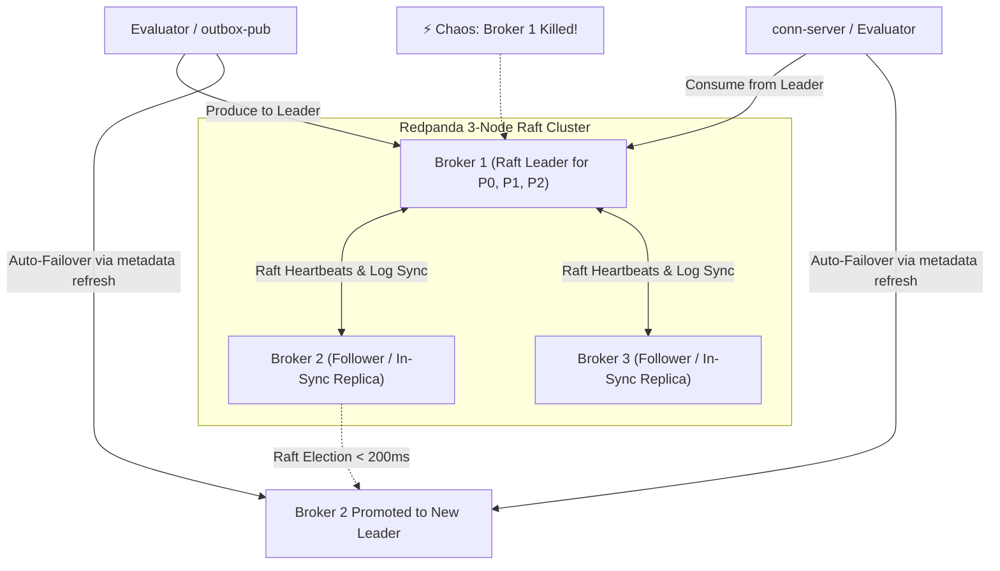
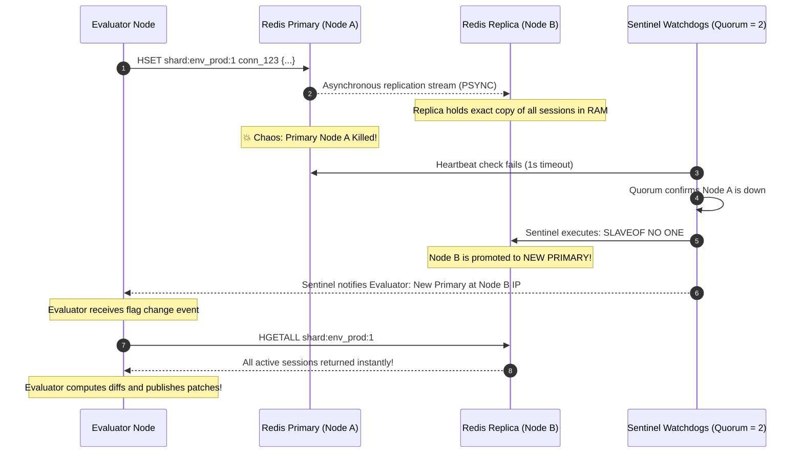

# Solving State Loss with Raft Consensus, Primary-Replica Failover & Thundering Herd Elimination

When chaos testing reveals that killing a stateful dependency (such as Redis or Redpanda) causes system failures, the natural engineering question is:

> **The Core Question**: *"Should just running a replica solve the issue?"*

### The Short Answer
**Yes, properly configured replication completely solves the issue.** 
Furthermore, it eliminates the **Thundering Herd** problem entirely because session state and partition logs are never lost during node failures.

However, "running a replica" means fundamentally different things for a Raft-native distributed log (Redpanda) versus an in-memory key-value store (Redis).

---

## 1. Redpanda: Native Raft Replication Solves It Out of the Box

Unlike Apache Kafka (which historically required a separate ZooKeeper or KRaft metadata quorum), **Redpanda has Raft consensus embedded directly into its C++ engine**.



### How a 3-Broker Cluster Eliminates the Failure:
1. **Replication Factor 3 (`--replication-factor 3`)**:
   - Every partition of `flag-changes` and `deliveries` is replicated across all 3 nodes.
   - Writes are acknowledged only when stored by a quorum ($\ge 2$ nodes with `min.insync.replicas: 2`).
2. **Sub-200ms Leader Election**:
   - When Broker 1 is killed, Brokers 2 and 3 notice missing Raft heartbeats within 150ms.
   - An election term is started, and an in-sync follower is promoted to partition leader in **$< 200\text{ms}$**.
3. **Transparent Client Failover**:
   - The Go Kafka client (`franz-go`) receives a `NOT_LEADER_OR_FOLLOWER` response on its next produce attempt.
   - The client immediately queries the remaining brokers for updated cluster metadata and transparently redirects writes to the new leader.
   - **Zero topics lost, zero partitions wiped, zero messages dropped.**

---

## 2. Redis: Why Naive Replicas Fail, and What Actually Works

In Kubernetes, if you simply edit `deploy/k8s/03-redis.yaml` and set:
```yaml
spec:
  replicas: 2 # ⚠️ NAIVE REPLICAS ANTI-PATTERN!
```
**This does NOT work.** It creates two completely isolated, independent Redis instances running behind the same Kubernetes Service:
- When the Evaluator writes `HSET`, the request hits Pod A.
- When the Evaluator queries `HGETALL`, Kubernetes round-robins to Pod B.
- Pod B returns an empty map because the pods are not replicating each other (Split-Brain).

---

### The Proper Solution: Primary-Replica with Sentinel Failover

To make Redis replication solve the issue, Redis must be deployed with **active replication and an automated failover watchdog (Redis Sentinel)**:



### Why This Completely Eliminates the Thundering Herd:
1. **Sessions Were Never Lost**: Because Replica B was continuously receiving replication bytes from Primary A, **Node B already holds 100% of the active user sessions in its RAM**.
2. **Zero Re-hydration Needed**: Neither Edge Servers nor Evaluators need to re-send session state.
3. **Zero Client Disconnections**: Mobile clients remain connected to Edge Servers undisturbed.

---

## 3. Alternative for Single-Node Redis: Persistent Volume + AOF

If you want high resilience without the operational overhead of running a full multi-node Redis Sentinel or Redis Cluster, you can use **PersistentVolumeClaims (PVC) with Append-Only File (AOF)**:

```yaml
apiVersion: apps/v1
kind: StatefulSet
metadata:
  name: redis
  namespace: feature-flags
spec:
  serviceName: redis
  replicas: 1
  template:
    spec:
      containers:
      - name: redis
        image: redis:7-alpine
        command:
        - redis-server
        - --appendonly
        - "yes"
        - --appendfsync
        - everysec
        volumeMounts:
        - name: redis-data
          mountPath: /data
  volumeClaimTemplates:
  - metadata:
      name: redis-data
    spec:
      accessModes: [ "ReadWriteOnce" ]
      resources:
        requests:
          storage: 10Gi
```

### How this works:
1. Every write (`HSET`) is logged to an Append-Only File on persistent SSD storage with `appendfsync everysec`.
2. When the Redis pod is killed, Kubernetes launches a replacement container that mounts the **exact same persistent volume**.
3. Redis replays the AOF file during startup, restoring all session keys to memory in **$< 500\text{ms}$**.

---

## 4. Production Architecture Topology Blueprint

```
                      [ Client Fleet (Mobile / Web) ]
                                    │
                                    ▼
                      [ Layer-7 Load Balancer ]
                                    │
                    ┌───────────────┴───────────────┐
                    ▼                               ▼
         [ conn-server (Slot 1) ]        [ conn-server (Slot 2) ]
                    │                               │
                    └───────────────┬───────────────┘
                                    │ HTTP RPC
                                    ▼
                      [ Evaluator Consistent Ring ]
                        (Coordinated via etcd)
                                    │
          ┌─────────────────────────┼─────────────────────────┐
          │                         │                         │
          ▼                         ▼                         ▼
 [ PostgreSQL (External) ]   [ Redpanda (Raft) ]      [ Redis Cluster ]
  • Durable Outbox WAL       • 3-Broker Cluster       • Primary-Replica
  • Logical Replication      • RF=3, min.isr=2        • Multi-AZ Failover
  • LSN Ack Protection       • Sub-200ms Leader Elec  • 0 Session Loss
```

---

## 5. Key Engineering Takeaways

1. **Raft for Partition Logs**: Redpanda's built-in Raft clustering provides automatic, sub-second failover for partitioned topics without external orchestrators.
2. **Replication Eliminates Re-hydration**: When data stores replicate continuously, failover is a simple pointer swap. The thundering herd problem is avoided by ensuring state is never lost in the first place.
3. **Decoupled Durability**: Using PostgreSQL WAL CDC as the ultimate source of truth guarantees that even if the entire messaging and evaluation tier experiences temporary downtime, zero configuration changes or audit events are ever dropped.
